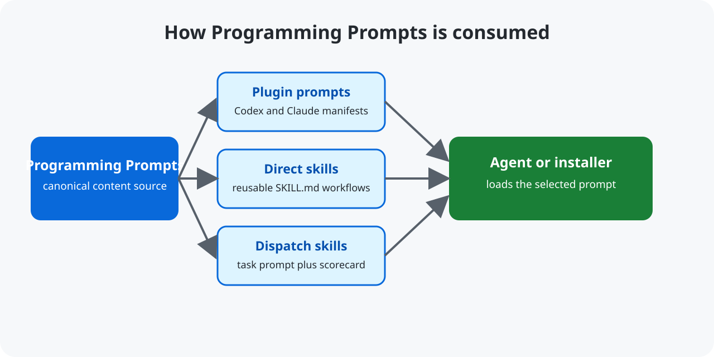

# Programming Prompts — AI Coding-Agent Prompts

[](https://github.com/mikaeltorni/programming_prompts/commits/master)
[](https://github.com/mikaeltorni/programming_prompts/graphs/commit-activity)
[](https://github.com/mikaeltorni/programming_prompts/issues)

Programming Prompts is a prompt library that provides reusable AI coding-agent prompts and engineering guidance for Codex and Claude Code users.



This repository is the canonical content source for the engineering standards
used across this workspace's projects. It contains installable plugins, direct
skills, and dispatch skills; the separate installer repository owns marketplace
generation and deployment.

All prompt and plugin releases use 0.x versions while this library remains a
work in progress. The October 11 reset in `35702ba` changed only release metadata
for 22 skills and four plugin manifests, preserving their minor/patch numbers.

## Contents

- [AI coding-agent prompt features](#ai-coding-agent-prompt-features)
- [Installation and usage of AI coding-agent prompts](#installation-and-usage-of-ai-coding-agent-prompts)
- [Plugins](#plugins)
- [Direct Skills](#direct-skills)
- [Testing](#testing)
- [Troubleshooting and FAQ](#troubleshooting-and-faq)
- [Contributing](#contributing)

The install catalog intentionally distinguishes plugins from direct skills:

- Plugins: Commit Guidelines and Linux Desktop Configuration.
- Direct skills: Docs, Init Project,
  Refactoring, Setup Repository Guidelines, and Workflow.
- Python Logging is retired and has been removed from this repository.

## Repository dependencies

This repository has no runtime dependency.

Repository ownership and routing are documented in [AGENTS.md](AGENTS.md).

Related research is documented in [Prompt Engineering for Software Development](https://github.com/mikaeltorni/prompt_engineering_for_software_development),
and challenge generation is covered by the
[Prompt Challenge Generator](https://github.com/mikaeltorni/prompt_challenge_generator).
For local conventional commit suggestions from Git diffs, see the
[coding_tools local AI commit message generator](https://github.com/mikaeltorni/coding_tools).

## Quickstart

Clone the content source and inspect a skill directly:

```bash
git clone https://github.com/mikaeltorni/programming_prompts.git
cd programming_prompts
sed -n '1,120p' programming_prompt_rewritten_with_evals/prompts/programming-skills/testing/SKILL.md
```

The command prints the independent testing skill. The programming suite
contains workflow, commits, worktree, docs, srp, commenting, logging, debug_logs,
debug, testing, and prompt_engineering; see its [skill catalog](programming_prompt_rewritten_with_evals/prompts/programming-skills/README.md).

## AI coding-agent prompt features

This repository maintains the canonical engineering standards used across all
development projects in this workspace. Plugin prompts package exactly one skill
and carry manifests for both Codex and Claude Code; direct skills carry only
`SKILL.md` content.

- **Testing Skill** — Focused regression checks, public-interface coverage, existing project tooling, and isolated execution; source: [testing](programming_prompt_rewritten_with_evals/prompts/programming-skills/testing/SKILL.md).
- **Workflow Skill** — Explicit-only orchestration that immediately establishes a selected editing worktree before detailed planning, coordinates only selected companion skills, and conditionally uses documentation guidance.
- **Docs Skill** — User-facing project documentation for completed programming changes.
- **Commit Guidelines** — Cautious Git commit workflow (inspect → plan → stage hunks → verify → compose).
- **SSH VM** — Connect to a VM for remote software deployment or verification, with Ubuntu live USB setup guidance.
- **Linux Desktop Configuration** — Shared GNOME/Ubuntu desktop rules: applying changes silently from the command line (gsettings/dconf live, `systemctl --user restart`, `gnome-extensions enable/disable`), activating edited extension code with the sanctioned in-place X11 run-dialog reload (`xdotool` `Alt+F2 r`) while still forbidding destructive session restarts, asking for manual logout to activate extension code on Wayland, preserving user sessions, maintaining clean-install compatibility, and using root-optional (sudo-free) installer patterns.
- **Refactoring Skill** — Test-driven refactoring methodology for restructuring monolithic codebases into clean modules.
- **Init Project Skill** — Auto-triggered secure project initialization with UV + supply-chain protection.
- **Setup Repository Guidelines** — On-request (or new-project) repository-family routing and installer integration based on the orchestration manifest; no longer auto-triggered on every task.

## Repository Structure

```
programming_prompts/
├── AGENTS.md                               # Rule: no marketplace files in this repo
├── plugins/                                # One directory per plugin; each has
│   │                                       #   .codex-plugin/ + .claude-plugin/ manifests
│   │                                       #   and exactly one skills/<name>/SKILL.md
│   ├── commit-guidelines/                  # Cautious Git commit workflow
│   ├── linux-desktop-configuration/        # Console-only desktop deployment + sudo-free installers
├── skills/                                 # Direct skills, not plugins
│   ├── workflow/                            # Explicit-only programming orchestrator
│   ├── docs/                                # Post-code project documentation
│   ├── init-project/                       # Secure init with UV + supply-chain protection
│   ├── refactoring/                        # Test-driven refactoring workflow
│   ├── setup-repository-guidelines/        # On-request setup-family routing & install policy
│   └── ssh-vm/                             # SSH deployment and testing on a VM
├── dispatch-skills/                        # Menu-selectable task skills: repo in, score out
│   ├── github-seo/                        # GitHub discoverability audit, scored 0–100, looped
│   ├── github-portfolio-scan/             # Directory-wide resume/portfolio release-readiness audit
│   └── worktree-cleanup/                  # Finished-worktree reclaim, scored, never stored
├── tests/                                  # pytest policy tests for the plugin prompts
├── .log/                                  # Runtime logs (gitignored)
├── LICENSE.md                             # MIT License
└── README.md                              # This file
```

## Installation and usage of AI coding-agent prompts

Installation belongs to the sibling installer repository. Its committed
`default.json` maps each prompt to either a plugin or a direct skill and
controls default selection. This repository intentionally
contains no `install.sh`, installer libraries, or marketplace catalogs — marketplace
generation is owned entirely by the installer repository (see `AGENTS.md`). Each
`plugins/<name>` directory stays standalone-installable via its own Codex and
Claude manifests plus its single skill. Top-level `skills/<name>` directories
are installed directly as skills and do not appear in plugin marketplaces.

## Plugins

### commit-guidelines

Packages the cautious Git commit workflow as a Codex/Claude plugin (skill name:
`commit`). Guides agents to inspect all changes (staged + unstaged), split diffs
into logical commits, stage exact hunks, and compose clean conventional commits,
executing the complete cross-repository commit plan in one run.

**Install:** The programming-prompts marketplace installs this as `commit-guidelines@programming-prompts`. Confirm with:
```bash
codex plugin list
```

### linux-desktop-configuration

Packages the shared Linux desktop configuration rules as a Codex plugin (skill name: `linux-configuration`). Applies to any task touching GNOME Shell extensions, gsettings, themes, hotkeys, systemd user services, or repository installers:

- **Apply changes silently from the console:** most changes need no Shell reload — `gsettings set` (hotkeys/themes/shell keys/an extension's own settings) applies live, `systemctl --user restart <unit>` restarts only the affected service, and `gnome-extensions enable/disable` toggles extension state without a GUI flash. For extension *code* changes, deploy and verify the files, then activate the edited source with the in-place reload that matches the session: on X11 drive GNOME's run dialog with `xdotool` (`Alt+F2 r`) to restart the Shell in place; on Wayland ask the user to log out and back in. Never force changes through with logout, reboot, `gnome-shell --replace`, or shell-kill commands.
- **Clean installation compatibility:** every change must reproduce on a fresh checkout via `installation_scripts/install.sh`; installers stay idempotent.
- **Root-optional installers:** all project `install.sh` scripts run sudo-free in user mode (root-only steps are skipped and reported via `SUDO_REQUIRED_STEPS`); only `linux_installations_setup` hard-requires root.

**Install:** The programming-prompts marketplace installs it as `linux-desktop-configuration@programming-prompts`. Confirm with:
```bash
codex plugin list
```

## Direct Skills

### ssh-vm

Use `$ssh-vm`, or let it apply automatically, for tasks that deploy or test
software on a VM over SSH. On first contact, if the user provides an IP or
hostname without confirming SSH setup, it gives Ubuntu VM-console setup
commands, including setting the account password, and waits for confirmation
before any network attempt. Once confirmed, it connects using a key or an
interactive password prompt, updates the project copy, and installs and checks
it on the VM. For visual behavior, it captures and inspects a VM screenshot
when a safe capture path is available. If visual confirmation would help but
no capture path exists, it asks the user for a screenshot. SSH alone does not
guarantee guest desktop access. Installed as a native skill under each
harness's skill directory.

### testing

Use `$testing` for ordinary public-interface tests: correct expected results,
relevant invalid inputs and boundaries, stateful sequences, isolation and a real
final test run. The [testing policy](programming_prompt_rewritten_with_evals/prompts/programming-skills/testing/SKILL.md)
uses existing tools or stdlib checks. It does not impose feature ledgers or
sentence-by-sentence implementation cycles; separately selected workflow and
commit policies own those requirements.

Refresh with `acc pp enable -v2 --skill testing`; check installation with
`acc pp status --skill v2:testing --check`. Its benchmark selector is
`--skills testing`; the judge gives one `testing_contract` verdict.

Revision v0.1.115 scored **32/32 (100%)** across all eight tasks with four
attempts each in archived run `2026-10-18_173046_2008563`. Coding and judging
used Codex `gpt-6-luna`/low on instance 2, with zero quota or infrastructure
failures. The archive confirms all 32 trials actually ran passing test suites,
collecting 142 test methods. Focused judge controls passed **21/21**; the original
15 expected verdicts remain unchanged. This result covers one frozen 32-trial sample.

The prompt requires completing requested work after initial inspection, checking
relevant malformed inputs, and reviewing saved assertions before the final run.
The judge grades actual assertions against the final revised contract. State
preservation needs meaningful assertions; public reads are preferred, and copied
snapshots or public results proving prior state are valid alternatives. Testing
adds no feature ledger, numeric-category matrix or prescribed read sequence.

The earlier v0.1.110 run `2026-10-18_162739_2545515` scored 28/32, with two
missing-error-check and two unfinished-work failures. Those raw verdicts remain
archived. Intermediate experiments that imposed extra test matrices or observer
methods were discarded. Scores from superseded rubrics are not directly comparable.

### prompt_engineering

Use `$prompt_engineering` when creating or editing prompts, skills or judges.
The [policy](programming_prompt_rewritten_with_evals/prompts/programming-skills/prompt_engineering/SKILL.md)
starts with **Do not overcomplicate**: use short clear instructions and the
simplest existing evaluation. Remove redundant rules before adding machinery.
Reuse original failures and independent cases, keep the main prompt and judge
aligned, and verify actual model outputs and parsed judge decisions.

Follow the user's acceptance criteria. Exact correctness cases and judge controls
must match their expectations. A sampled benchmark reports its pass rate and
remaining errors; 100% is required only when the user asked for it.

Refresh with `acc pp enable -v2 --skill prompt_engineering`; verify with
`acc pp status --skill v2:prompt_engineering --check`. Both policies are applied
to all nine configured harness families. Prompt engineering remains optional in
fresh-install and benchmark defaults; select its two benchmark cases with
`--skills prompt_engineering --tasks prompt-create,prompt-repair`.

Revision v0.0.66 requires a saved evaluation command that submits the tested
prompt text with each input and verifies actual answers plus fixed wrong judge
controls. It also checks for ignored model-setting options; Codex uses
`model_reasoning_effort`. Creation needs no invented broken baseline.

The final two-task run `2026-10-18_164039_3322724` passed **2/2**, with seven
main answers and 17 judge decisions independently checked. Focused judge controls
passed **5/5**, including rejection of an actual run with an ignored reasoning
setting. The full run used Codex `gpt-6-luna`/low on instance 2 with zero quota
or infrastructure failures. Earlier failing runs and their raw verdicts remain
archived; the rejected settings evidence was not relabeled as a passing run.

### workflow

Select `v2:workflow` to follow four stages: establish worktree, plan, complete
one Feature's checks → code → commit/delivery, then write documentation.
The [policy](programming_prompt_rewritten_with_evals/prompts/programming-skills/workflow/SKILL.md)
owns this cycle even without companions; selected companions add their contracts.
With `commits`, each complete capability sentence defines one Feature, keeping
its commands and optional clauses together. Finish the entire queue.

Retain the physical live root, task checkout and authoritative plan path.
Use an absolute `ACC_WORKFLOW_FILE` inside the live root's `tmp/workflow/`,
otherwise `<live-root>/tmp/workflow.md`. The ignored plan has four `Tasks` rows
and seven `Microsteps` columns: Step, Phase, Feature, Stage, Action, Status,
Evidence. Each code Feature has consecutive 3.1, 3.2, 3.3 rows. Read the first
unfinished step, record actual results/hashes and close selected delivery before
advancing; both outer rows and microsteps must be complete at handoff.
Plan separate documentation actions from the start: write and verify the root
README, then **Commit documentation**. Both use `Write documentation` as Phase
and `-` for Feature/Stage. The commit action records its actual hash and selected
worktree delivery before the documentation phase can complete. Explicit no-commit
instructions or absent Git skip that action with a reason; unselected docs skip
both actions. ACC shows these actions in Todo/Completed and the active docs
caption, so the docs commit remains visible while pending and running.
Implementation follow-ups update this plan, preserving unfinished work or
archiving a completed plan beside it. Reuse the verified task checkout.

Agent Command Center consumes this schema for its progress display. Policy
source edits do not activate native harness instructions by themselves;
selection/deployment stays with ACC and the external installer.

### docs

Writes or updates the user-facing documentation affected by a completed code
change. It covers the public entrypoint, commands or API, supported inputs,
configuration, and important usage constraints without taking ownership of
function docstrings from a separately selected commenting skill.

### testing and the programming suite

The [programming skills](programming_prompt_rewritten_with_evals/prompts/programming-skills/README.md)
are independently selectable policies. Their [matching judges](programming_prompt_rewritten_with_evals/evals/judges/README.md)
score the same behavioral requirements, without adding another policy's artifacts.
`testing` covers correct public results, relevant errors and boundaries, stateful
sequences, preservation after rejection, isolated fixtures and actual test
execution. Use existing tools or stdlib checks. Save a regression before fixing
a reported bug; ordinary creation does not require tests before each capability.
Selected workflow and commit policies own their separate implementation cycles.
Static content and project test prohibitions use direct verification.

SRP establishes parser, operations and applicable validators before the first
application write, including a supplied mixed entrypoint's first repair. The
parser returns converted arguments; called validators own every requested
converted-value/resource acceptance rule, even with one caller. Separate
operations own calculations and stored-state mutations. Dispatch parses once
and forwards arguments unchanged. It may read/format stored state without a
getter; assigning a global or stored field is still mutation when a helper
calculates the right-hand side. Reuse genuinely identical domain decisions;
different arithmetic does not require a shared updater merely because it touches
one variable. Commenting and logging cover authored test functions and helpers
as well as application functions. Docs requires the delivered root README after
all selected Feature cycles.

The October 10, 2026 content revision shortened the policy suite by about 65%
and judge text/configuration by about 80%. It removed repeated audit procedures,
mandatory coverage inventories, literal ledger grading and testing's source-site
question expansion. The October 10 testing judge used one `testing_contract` criterion
covering that revision's obligations; immutable `debug_behavior` correctness
contracts remain separate. Static validation, actual instruction assembly and
isolated judge packaging passed. No benchmark was run for this revision, so
its effect on pass rate remains unverified and archives retain their verdicts.

The subsequent October 10 audit corrected judges that mistook read-only review
for an edit, required superseded or duplicated stateless checks, or treated
logging and numeric conversion as misplaced parsing/domain logic. SRP now receives
numbered current source and existing function-boundary evidence. That historical revision
clarified future commands, commit timing, rejection observations and worktree
names. The current testing policy above supersedes its testing chronology
requirements.
Valid bundled histories, incomplete checks and layout mismatches still fail.

Verification uses the supported `evals/run_benchmark.sh` entrypoint and archived
source, history and sessions. The final six-task Codex sample scored 5/6:
testing, worktree and SRP each passed 6/6; one bank history genuinely bundled
capabilities. The last complete default three-attempt run, before the final
clarifications, scored 22/42. Both runs had no rate limits or infrastructure
exclusions and used `gpt-6-luna`/low for coding and judging. Corrected positive
and retained negative judge replays passed, as did all 36 worktree checker cases.
These samples do not establish a complete-suite pass. Grok and Claude runtime
smokes could not authenticate; their empty-workspace verdicts are not acceptance.

The October 11 archive `2026-10-11_003606_345540` finished at 49/70 with no
rate-limit or infrastructure exclusions: commits 32/40, SRP 28/40, testing 36/40,
worktree 37/40. Its follow-up audit retained genuine bundling, missing state reads
and layout failures. Small wording changes clarify sentence boundaries, numeric
acceptance ownership and scratch placement; judges recognize exact-match parsing,
parsed-selector routing and uncalled test definitions. No tests, benchmarks or
judge replays ran for this follow-up; its effect on pass rate remains unverified.

The fast archive `2026-10-11_014743_461020` exposed genuine commit bundling and
parser ownership failures alongside judge mistakes. A small follow-up clarifies
separate cycles for same-command revisions, converted parser results, shared
validation, invoked checks and replaced expectations. SRP judging accepts valid
simple parser forms; testing coverage claims must cite the original contract.
The updated skills are applied locally; their next positive rerun remains pending.

The earlier k10 archive, `2026-10-11_022519_2732605`, scored 113/140 in 13m01s
with no quota or infrastructure exclusions. SRP scored 68/80, testing 74/80,
commits 71/80, docs 78/80, and debug plus its separate behavior contract 60/60.
Small follow-up changes clarify normalization/domain ownership, distinct
introducing commits, replacement expectations in old rejection loops and README
completion. Judges distinguish valid routing/logging/formatting, repaired
baselines, specified bounds and rejected calls; they preserve genuine bundling
failures. Docs additionally checks requested command names from the original
`/tests/task.md`, reporting unavailable command evidence when that file is absent.
The changes are delivered in `28c40e8` and `0c5af99`. Codex skill copies match
the source; the selector preserved an existing unmanaged Claude docs copy.
No tests, benchmarks or judge replays ran for this follow-up, so its new pass rate
remains unverified. Debug, worktree and scheduling were unchanged.

The earlier k10 archive, `2026-10-11_031057_869951`, scored 106/140 with zero
quota or infrastructure exclusions. SRP scored 67/80; commits 70/80; docs,
testing, worktree and commenting each 77/80; logging 79/80; debug 58/60;
the separate immutable debug behavior contract 60/60. All 140 coding and 465
judge session records used `gpt-6-luna` with low reasoning.

Every one of its 38 failed criteria across 34 trials was audited individually.
Small repairs in `13b0015` and `790b5c1` clarify complete parser ownership,
same-sentence required commands, test-method documentation, collected checks,
immediate rejection observations, final README delivery and task-tip merges.
Judges respect supplied seed code, parser composition, actual exit reachability,
original domain requirements and the final saved debug regression. Docs entrypoint
discovery excludes scratch files under `tmp/`. Genuine violations remain failures.
The changes are merged locally and applied to managed native copies. Existing
unmanaged Claude commenting, debug and docs copies were preserved. No tests,
benchmarks or judge replays ran for this follow-up; its pass rate remains
unverified. Scheduling and model/reasoning settings were unchanged.

The earlier k7 archive, `2026-10-11_103821_1615535`, scored 83/98 overall and
47/56 for commits (83.9%), with zero quota or infrastructure exclusions. All
98 coding and 325 judge session records used `gpt-6-luna`/low. Each of its nine
failed commit verdicts has a genuine violation: eight bundled capabilities,
and one stalled at an expected missing-file creation baseline. Some judge
reasons incorrectly split optional clauses or misread baseline chronology;
one related passed trial ignored an earlier merged commit's future behavior.
Small repairs in `a299960` clarify separate sentence rows, committing before the
next capability's checks, later form changes, valid creation baselines, and judging
the earliest executable occurrence across task and delivered live history.
The changes are merged and applied to managed native copies; five existing
unmanaged Claude policy copies were preserved. Archived scores remain unchanged.
No tests, benchmarks or judge replays ran, so the repaired pass rate remains
unverified. Scheduling, verifier runtime and model/reasoning settings are unchanged.

The earlier k7 archive, `2026-10-11_111226_3493815`, scored 81/98 overall in
9m24s with zero quota or infrastructure exclusions. Commits scored 49/56,
SRP 52/56 and testing 51/56. All 98 coding and 325 judge sessions used
`gpt-6-luna`/low. Its 21 failed criteria across 17 trials were audited individually:
two verdicts contradict the recorded debug baseline and allowed SRP formatting;
19 have real violations, including bundled or uncommitted capabilities, missing
rejection observations or prints, misplaced conversion and stale docstrings.
Related positive verdicts also overlooked split same-sentence commands and an
earlier SRP violation. Small repairs in `ab3aa81` clarify those boundaries and
judge the actual runner's files and chronological evidence. Six changed skills
received 0.x patch bumps and are applied to all nine harness families, including
all Codex accounts and Claude. Archived scores remain unchanged. No tests,
benchmarks or judge replays ran; the repaired pass rate remains unverified.
Models, reasoning, runtime, scheduling and immutable behavior checks are unchanged.

The latest k10 archive, `2026-10-13_205215_3860584`, scored 109/140 overall
with zero quota or infrastructure exclusions. All 140 coding and 463 judge
sessions used `gpt-6-luna`/low. Its 33 failed criteria across 31 trials were
audited individually. Two clear judge errors concern an identical README copy
hiding a merged task commit and a caller already printing its own result.
Most failures are genuine: bundled capabilities, stale docstrings, incomplete
parsers, missing rejection observations or misplaced task files. Twelve focused
commits from `ca646c1` through `6dc89ce` repair the responsible policies and judges;
eight changed skills received 0.x patch bumps and are current in all nine harness
families. Archived scores remain unchanged. No tests, benchmarks or judge replays
ran, so the new pass rate and changed worktree checker's execution remain
unverified. Scheduling, models, reasoning and immutable behavior checks are unchanged.

ACC's existing default set is `commits`, `worktree`, `workflow`, `docs`, `testing`,
`srp`, `commenting`, `logging`, `debug`. Benchmark discovery excludes opt-in
`workflow`, `debug_logs`, and `prompt_engineering`; `logging-vague` remains a control. Dedicated repair
trials receive `debug`, while other selected policies retain their coding family.
Defaults and native selections were not changed by this content revision.
Acceptance uses `gpt-6-luna` with low reasoning for both coding and judging.
Before any future Codex benchmark command, verify every configured instance's
current 5-hour and weekly quota and the chosen auth home; old instance examples
are not evidence of available quota. Follow [AGENTS.md](AGENTS.md) and the
[evaluation README](programming_prompt_rewritten_with_evals/evals/README.md).

### init-project

Secure project initialization as a direct skill. Guides agents to set up new projects with UV by Astral as the required package manager, implementing a rolling 24-hour publication delay via uv's native `[tool.uv] exclude-newer = "24 hours"` setting to protect against supply-chain attacks. Plain `pip` installs must consume a hash-locked `uv export` rather than resolve dependencies directly.

### refactoring

A direct skill that implements the **Test-Driven Refactoring** paradigm. Guides agents to restructure monolithic codebases into well-organized, single-responsibility modules without changing behavior — tests first, then extraction, then integration.

Key principles:
1. Analyze before touching code (identify monoliths, orphaned functions, missing tests).
2. Plan the module structure with clear responsibilities.
3. Write tests for existing functionality before extracting anything.
4. Extract one cohesive module at a time by default; for explicitly broad workspace requests, inventory every repository first and verify each extraction independently.
5. Update imports, documentation, logging paths, and project tree after each extraction.
6. Commit each completed extraction in the task worktree by default.

### setup-repository-guidelines

A direct skill (not an auto-applied global instruction) that applies owner
routing, component selection, clean-install, deployment, and prompt-free
keyring requirements to the repository family discovered from the sibling
`installation_scripts` manifest. Invoke it only when the user requests repository
initialization or explicitly invokes `setup-repository-guidelines` by name or tag
(`$setup-repository-guidelines` or `/setup-repository-guidelines`). Missing
guidelines or a new directory do not trigger it. It is not merged into
`AGENTS.md`/`CLAUDE.md` as a managed
global conditional that fires at the start of every task. Membership is still
read dynamically from `CLONE_REPOS`, so newly added repositories enter scope
without changing this skill.

## Dispatch Skills

`dispatch-skills/` holds the task prompts that are meaningful with no context
beyond "here is a repository". They are the only prompts offered by the
notes-app skill menu, which launches one agent per selected project with the
harness-native invocation — `/name` for Claude Code, Cline, and Grok, `$name`
for the Codex family — built from the skill's directory name.

A prompt qualifies for this folder only if it defines a measurable score — kept
in a tracked scorecard file, or reported in the run output when storing the
audit would commit private detail — and an improvement loop with an explicit
stop condition; see [`dispatch-skills/README.md`](dispatch-skills/README.md).

### github-portfolio-scan

Audits **any directory** of git checkouts for GitHub resume / portfolio
release-readiness. It inventories live original repositories, scores each one
on product story, docs, tests, license, secrets, personal-machine coupling, and
authorship, then reports a tier list with evidenced positives and flaws. The
run is read-only: it does not edit, push, or change visibility, and it does not
apply SEO extras — those wait for a later [`github-seo`](dispatch-skills/github-seo/SKILL.md)
dispatch after a repository is chosen for public release. The audit lives in
the run report, not in the scanned trees.

### github-seo

Audits a GitHub project's discoverability against a weighted 100-point rubric —
repository metadata and topics, README above the fold, keyword coverage,
AI/LLM citability (question-shaped FAQ, a quotable definitional
sentence), community health signals, docs-site technical SEO, registry presence,
cross-links, and freshness — minus penalties for keyword stuffing,
unsupported claims, badge and topic spam, artificial engagement, and dead links.
For mikaeltorni's repositories, per-criterion evidence and round history live
in the private `seo_optimization` repository, not in this public content
source. The loop closes the highest-value gap, re-measures from scratch, and
repeats until a re-audit independently reproduces 100/100, then switches to
maintenance. Points are only awarded against recorded evidence, and nothing is
published, renamed, or posted on the user's behalf.

## Logging

Per the programming guidelines, any repository-generated log files must be
written under the repository-root `.log/` directory (created on demand) and are
gitignored to keep the working tree clean. No runtime utilities currently ship
in this repository, but the convention is reserved for any that are added later:

```bash
# Repository-generated logs live here (gitignored)
.log/<component>.log
```

## Testing

Run the test suite with pytest:

```bash
python3 -m pytest tests -v
```

Each plugin is standalone-installable and can be validated directly:

```bash
claude plugin validate --strict plugins/<name>
codex plugin list
claude plugin list --json
```

The Harbor benchmark's public entrypoint is
[`run_benchmark.sh`](programming_prompt_rewritten_with_evals/evals/run_benchmark.sh).
Coding tasks live under
[`evals/coding-prompts/`](programming_prompt_rewritten_with_evals/evals/coding-prompts/);
`greeter` remains the staged log-guided coding task (`/app/greeter.py` →
`run_greeter` for `<name> <hour>`, `bye <name>`, and `period <hour>`).
The runner accepts `--harness`, selects the Codex judge with
`--eval-agent codex`, selects programming skills with `--skills`, and accepts
`--tasks`, `--suite coding|debug|all`, `--concurrency`, `--baseline`,
`--run-separately`, `--install-only`, `--pin-refresh` / `--no-pin-refresh`,
`--eval-agent-model`, `--eval-agent-reasoning-effort`, and Harbor's `-k` attempt
count. The [parameter table](programming_prompt_rewritten_with_evals/evals/README.md#parameters)
describes their values and defaults.
Without `--concurrency`, all selected tasks × attempts remain eligible, subject
to configured LLM caps and available per-trial Docker network slots. The automatic
[launch guard](programming_prompt_rewritten_with_evals/evals/harbor_agents/launch_guard.py)
keeps that full ceiling for running trials and separately bounds simultaneous
setups to half the host's available CPUs (at least one). On a 16-CPU host,
eight trials may set up at once; each releases its setup slot when its agent
starts, allowing more setups while existing coding and judging continue.
Available Docker storage further bounds simultaneous setups with an 8 GiB
allowance per setup and a 2 GiB shared reserve. That build allowance is released
when the agent starts; it does not cap trials already coding or judging.
For the default 14-task suite, `-k 5` therefore retains its configured
70-trial ceiling while setup proceeds within the CPU and storage limits.
`EVAL_SETUP_MAX_CONCURRENT` can impose a lower setup cap. New starts also wait
when admitted setup work reaches half its environment startup budget or a
running agent approaches its deadline. Agent headroom is the 95th percentile
of recent setup durations plus five seconds. Holds clear as the affected phases
finish, without permanently reducing capacity. Waiting happens before setup
and agent timers, so queued trials retain their full budgets.
The guard applies to Codex, Claude Code and Grok in positive and baseline runs.
The generated job configuration gives each agent up to 1200 seconds (20 minutes)
of execution, replacing the task's 600-second allowance. Successful agents
return immediately; this allowance does not add a wait or change concurrency,
setup limits or verifier budgets. The launch guard uses the effective execution
deadline, including Harbor's configured timeout maximum and multiplier.
It avoids starting new containers close to active deadlines but cannot guarantee
a task finishes before its own deadline. Use `--concurrency N` only to impose a
lower ceiling; no flag is needed
for pacing. `-k` controls attempts per task independently. Console summaries
include trials that failed before verification and show both `trials` and
`scored` counts; infrastructure failures are reported separately from pass rate.
Summary and archive helpers do not print raw trial paths, returned values or
`None` traces while classifying trials and rebuilding the results index. The
formatted results, failure details and archive destination messages remain.
The launch guard prints its capacity configuration once at startup; polling,
per-trial admission and instruction-registration helpers run without verbose
traces or shell-command dumps. Running jobs keep their already-loaded code;
these console changes take effect on the next benchmark invocation.
A subsequent user-run k5 archive, `2026-10-11_014743_461020`, completed in
6m23s with 13 quota-affected trials excluded. It confirms faster observed
throughput, while quota failures prevent clean acceptance of that run.
Run one benchmark invocation at a time. See the
[evals README](programming_prompt_rewritten_with_evals/evals/README.md) for the
command surface and [AGENTS.md's benchmark guidance](AGENTS.md#benchmark-commands-give-the-simple-default)
for the simple default command: one positive Codex run with three attempts per
task. Extra harnesses, baselines and comparison runs are supplied only when
requested; each Codex command requires a current quota and auth-home check.

`--skills` selects the Harbor skills and corresponding verifier judges;
positive jobs install the selected skill bodies, while baseline jobs omit them.
`workflow` requires explicit selection. Generated task instructions explain
that `/Projects/app` is the writable Git checkout and `/app` resolves to it.
Creation tasks may start empty; agents are authorized to create the requested
files there and must finish implementation before reporting delivery. Baseline
and positive jobs receive the same workspace setup. Verifier task context keeps
the unmodified original coding request.
An initial file search with no matches or exit status 1 is expected in an empty
creation checkout; continue by creating the authorized files. The counter task
explicitly uses one process-local value initially zero, retained across calls
to increment, decrement, get and set. This clarification matches its oracle.

For a local content deployment without starting a benchmark, run
`./sync_tasks.sh` followed by `./sync_judges.sh testing` from `evals/`.
They rebuild ignored `.generated/tasks/` copies and copy the selected judge
and shared verifier. `TASKS_DIR` can target a specific generated task directory.
Do this when no benchmark is running; the benchmark wrapper also regenerates
its own isolated job copies from canonical source when a new run starts.

The [SRP skill](programming_prompt_rewritten_with_evals/prompts/programming-skills/srp/SKILL.md)
also guides focused edits: save the ownership layout with the first working
slice, extend its existing helpers and command path, and preserve responsibilities as requirements
change. The `todo`, `bank`, and `stats` benchmark prompts repeatedly revise
earlier behavior as well as adding commands. Each stage requires public-entrypoint
checks and a working commit; the SRP judge receives historical source and diffs
to assess unnecessary churn alongside the final function structure. A justified
local extraction is allowed, and diff size alone is not the score.
Before introducing another operation, compare its decisions with existing
owners and extract any shared classification, calculation or validation once.
Keep operation labels and effects in their respective owners. Successful token
conversion establishes representability; operation-specific sign, magnitude,
finite-value and integral-value requirements stay in validators called by operations,
including historical revisions before a later requirement changes acceptance.

Semantic judges receive the actual source, function boundaries, workflow plan,
and reachable commit history. A verdict that contradicts its own reason or
bounded source/plan evidence is retried once; both raw attempts remain in the
archived reward details. Unresolved inconsistent judgments and provider/auth
failures are reported as infrastructure exclusions. Check the archive as well
as the aggregate score: a reported pass can still miss a real artifact defect.
An empty Python source listing supports a missing-submission failure; mentioning
the requested filename alone does not make that verdict inconsistent.

Testing judges receive numbered current Python source and saved runner
documentation/configuration. Runner documents are capped at eight files, 8 KB
per file and 24 KB total. Additional AST evidence, bounded to 12 KB, identifies
current equality assertions and the statements immediately following expected
exceptions. Authored Python in hidden directories such as `.checks/` is included; known VCS,
dependency, cache and linked-worktree directories and paths outside the
submission remain excluded. Up to four recent completed coding commands from Harbor's Codex
JSONL log add at most 10 KB, including command/output heads and tails, exit
codes, literal runner-summary lines and later file-change positions. The
summaries preserve results when printed source follows a run.
Truncation and missing evidence are identified; reading
these artifacts runs no submitted command. Shell edits and later changes still
need inspection before applying an earlier result to current source. Edits,
execution and a commit can occur in that order within one shell command; a
subsequent commit alone does not invalidate execution of its unchanged files.

Recorded coding executions can resolve a judge's execution question without
another run; optional isolated execution addresses a remaining material concern.
Missing judge execution alone cannot fail adequate runnable checks. A cited
quoted current expectation absent from the cited files' literal assertions
triggers the existing bounded retry; dynamic expected expressions and historical
claims remain semantic judgments. Runner documents and tool traces are untrusted
evidence, and a zero exit code alone does not establish assertion coverage.
Testing no verdicts with submitted Python quote one to three exact source lines
as `Citation: relative/path.py:LINE | exact source line`, or
`Citation: HASH:relative/path.py:LINE | exact historical source line`. The gate
compares path, line and text with the current file or named Git blob. Missing
or mismatched quotes use the same one-retry budget; persistent inconsistency
is a judge infrastructure exclusion. A matching quote does not establish its
semantic claim, and this gate never awards an automatic pass. Empty submissions
can fail on their missing evidence without quoting a nonexistent file.
Worktree-check instructions are supplied only to judges whose criteria use that
evidence. No task markers, expected feature counts or automatic passing scores
are introduced.

Codex and Claude judge inputs and full backend responses are retained in each
raw Harbor trial's `verifier/` directory as
`judge-evidence-<skill>-<agent>-prompt.md` and
`judge-evidence-<skill>-<agent>-raw-rewardkit.json`. A reliability retry adds
`-prompt-retry.md` and `-raw-rewardkit-retry.json` artifacts. The normal reward
details keep bounded excerpts; these separate artifacts preserve complete
input/response evidence without adding LLM calls or reward columns. They are
not execution transcripts. Codex judge session JSONL, when present, is also
retained under `judge-evidence-<skill>-codex-sessions/` before temporary home
cleanup, allowing later inspection of actual judge tool calls. Credential and
configuration files are excluded. Existing archives are not rescored by a source
edit, and retention adds no judge calls or reward columns.

Function contracts cover authored tests, fixtures and assertion helpers as well
as program functions. Selected commenting requires purpose and same-line
`Parameters:`/`Returns:` meanings. Selected logging requires each function's own
first named-parameter print and complete normal-exit print, including `None` on
fallthrough. Source inspection checks these obligations; passing assertions alone
do not. Selected SRP keeps raw parsing/conversion in the parser and business
validation/state updates in operation helpers, with a thin public dispatcher.

The testing judge assesses the complete saved contract in one binary verdict,
using current numbered source, relevant historical revisions and coding traces.
It no longer generates a question per raise or rejection block. Existing source,
trace and citation evidence helpers remain available. SRP requires
`parsing_dispatch`, `domain_validation`, and `shared_decisions` to all pass.
A missing trace is an
explicit verification limit, not evidence that code preceded tests. Required early
rejections remain valid until the capability that replaces them, and a current
query upgrade to an older test body belongs to the query's current Feature.
Findings must identify a concrete violated rule with authentic evidence.
The testing judge inspects recorded execution; it does not run or edit submissions.
The new single-criterion detail schema differs from historical expanded testing
results; do not claim direct per-criterion comparability or rescore old archives.

Testing completes each behavior sentence's saved checks → baseline → implementation
→ cumulative pass before saving the next sentence's checks. Commands joined in one
sentence stay together. Saving every capability's checks up front is a bundled
cycle; a baseline failing on the current missing behavior is expected.

Mutable rejection checks establish state through successful public mutations and
immediately assert public values and required history inside each rejection loop.
A seed before the loop can cover its iterations. Valid empty queries observe
emptiness through their asserted exception; required empty-state mutation failures
retain empty fixtures and assert available reads. A new query upgrades older
rejection bodies too, including helper callers whose optional read would otherwise
be skipped. Expected values come from the contract and preceding calls.
Judge calibration on saved answers does not measure a fresh coding pass rate;
retain the original archived rewards and report remaining explanation errors.

The original task and selected policy define testing requirements. Generated
README restrictions and implementation guards cannot add required rejection cases.
Coverage is the union of saved checks and called helpers: shared blank/unknown
checks need not be copied into each test, and invalid numeric text needs a
representative for each operand rather than every spelling. Literal expected
results and calculations from known fixture inputs are independent; copying an
unchecked actual result into the expected baseline is not.

Testing evidence includes current numbered source, saved runner documentation and
a compact action timeline. Each command is rendered once with its observed status,
bounded output and literal runner summaries, including failures hidden in output
middles. Full raw transcripts and named historical-source lookup remain available.
Bulk Git histories, workflow plans and duplicate syntax/raise inventories are not
inlined for testing. Other judges retain their existing evidence routes. Missing
or shortened evidence must be inspected or disclosed, rather than scored as an
invented source defect. Public aggregates are valid when they are the only value
view; their limits do not create an unavailable per-resource getter.

An explicit no-test instruction takes precedence over execution and calibration
steps. Such a repair may use saved source/log analysis and static review; report
that limit and make no new benchmark pass-rate or runtime-verification claim.

The docs verifier requires the requested public API in the root README;
internal checking helpers do not become additional product entrypoints.

Debug/testing judges receive verifier-owned original failure logs in
`tests/task-logs/`; agent-editable logs cannot redefine expected results.
Debug requires a saved public regression before repair. `debug_logs` alone adds
no regression or commit obligation. The separate `debug_behavior` judge executes
immutable public behavior contracts. Worktree and docs remain programmatic.

Codex semantic judges stream full prompts through file-backed stdin to avoid
Linux argument limits. Archived prompt/backend evidence remains independent of
coding execution transcripts. These runtime mechanisms and public task contracts
were not changed in the simplification.

The delivered SRP revision is **v0.0.62**.

Verification uses Codex for both coding and judging, with `gpt-6-luna` and `low`
reasoning. The last complete full run,
`2026-10-15_235102_3772959`, recorded SRP 23/24 with no exclusions.
Semantic judgments remain fallible;
authentic citations prove quoted text, not the conclusion drawn from it.

## Configuration

This content repository has no runtime configuration. Plugin manifests,
direct-skill directories, and `dispatch-skills/` are the source of truth; the
installer reads them when it deploys prompts to an agent environment.

## Troubleshooting and FAQ

### Where should I start with Programming Prompts?

Start with the [programming skill catalog](programming_prompt_rewritten_with_evals/prompts/programming-skills/README.md)
and select the capabilities your task needs. Use `workflow` for explicit
coordination and `testing` for verification. Browse the [plugin directories](plugins/)
for packaged Codex and Claude Code integrations.

### Is this repository a plugin marketplace?

No. It is the content source for plugins and skills. Marketplace generation and
installation are owned by the external installer workflow, so no marketplace
catalog is committed here.

### Which prompt is used for GitHub SEO audits?

Use the [github-seo dispatch skill](dispatch-skills/github-seo/SKILL.md). It
audits a repository, records a scorecard, and loops over verified gaps.

### Which prompt ranks a folder of repos for a GitHub resume portfolio?

Use the [github-portfolio-scan dispatch skill](dispatch-skills/github-portfolio-scan/SKILL.md).
Point it at any directory of git checkouts. It inventories live originals,
scores release-readiness, and reports positives and flaws without editing those
trees. Run `github-seo` only after you pick a repository to make public.

### How do I validate a plugin?

Run `claude plugin validate --strict plugins/<name>` from a checkout with the
Claude Code CLI installed. The two plugin directories each contain their own
Codex and Claude manifests.

### Why is there no install.sh in this repository?

The repository deliberately keeps deployment ownership in the sibling
installer. Direct skill and plugin content remains independently inspectable
and can also be installed from its directory by compatible CLIs.

## Contributing

Keep each skill self-contained, preserve the plugin/direct-skill ownership
rules in [AGENTS.md](AGENTS.md), and run `python3 -m pytest tests -v` before
opening a pull request. Changes to prompt-only content should include a clear
description of the behavior or policy they improve.

## License

This project is licensed under the [MIT License](LICENSE.md).

## Disclaimer

This software is provided under the MIT License on an **“as is”** basis, without warranties of any kind. To the maximum extent permitted by applicable law, the authors and copyright holders shall not be liable for any claims, damages, losses, or other liability arising from the use of this software.

You are solely responsible for determining whether this software is suitable, safe, lawful, and appropriate for your intended use. Unless explicitly stated otherwise, this project is general-purpose software and is not designed, tested, certified, or approved for safety-critical, medical, automotive, aviation, industrial-control, life-support, cybersecurity-critical, financial-critical, or other high-risk use cases.

The authors and copyright holders make no guarantees regarding security, reliability, availability, correctness, compliance, non-infringement, or fitness for any particular purpose.

This notice is intended to clarify the nature of the project and does not impose additional restrictions beyond the MIT License.

## Global instruction assembly

`scripts/global_instructions.py` provides `render_instructions` and
`write_instructions` to combine selected instruction texts into one global
Markdown file. The writer replaces only owned blocks and preserves unrelated
user instructions.

Build selected policies with Python 3.11 or newer (standard library only):

```bash
python3 scripts/global_instructions.py --skills v2:workflow,v2:commits,v2:worktree,v2:docs,v2:testing --runtime codex --config-home ~/.codex
```

Accepted parameters: `--list`, `--skills` (comma-separated, family-qualified
when ambiguous), `--source-root`, `--output`, `--runtime`, `--config-home`, and
`--bundle-dir`. An empty `--skills ''` clears managed selections while retaining
personal instructions. `--output` writes an explicit destination; otherwise
`--runtime` and `--config-home` resolve the native file. `--bundle-dir` creates
a transport bundle for isolated evaluation instances. `--list` prints available
policy names. Harbor uses the same builder to package one document
per job, then places it in each trial's native global file. Baselines clear
native instruction and skill surfaces; task prompts and judges are unchanged.
Generated documents contain a global overview, the selected policy list, and
one section per source with its original metadata and complete body. Markdown
headings are nested while fenced examples remain verbatim. Source files and
judge definitions are never rewritten by assembly.
The same CLI supports Codex, Claude, Grok, Cline, OpenCode, Cursor, and the
Local/Qwen, OpenRouter, and NVIDIA Codex homes (their ACC aliases are accepted).
Codex destinations receive at least a 1 MiB document budget to accommodate the
full combined instructions. ACC installs the tool as `acc-build-instructions`.
`instruction_path` resolves Codex's `AGENTS.md` and Claude's `CLAUDE.md`
under an explicit instance home, or `CODEX_HOME` / `CLAUDE_CONFIG_DIR`.

## Log reading and debugging

[`debug_logs`](programming_prompt_rewritten_with_evals/prompts/programming-skills/debug_logs/SKILL.md)
preserves the existing read-logs-first policy. The separate
[`debug`](programming_prompt_rewritten_with_evals/prompts/programming-skills/debug/SKILL.md)
skill guides diagnosis, reproduction, focused repair and verification. Its log
instruction names no fixture folder, scenario or answer.

The [dedicated repair cases](programming_prompt_rewritten_with_evals/evals/debug-prompts/README.md)
cover timezone/date conversion, cache results crossing tenant boundaries, and
stock mutation after a rejected reservation. More complex cases combine atomic
multi-item orders and retries, cache expiry and mutation invalidation, or UTC
booking conflicts and failed-move rollback. Each ships a genuinely broken
program and a public contract. Agents discover executed original failures in
the project-root `.log/failure.log`; judges retain an independent original in
`tests/task-logs/`. The semantic judge checks the repair and available
chronological evidence. A separate `debug_behavior` judge executes immutable
public-call sequences, including varied inputs and immediate observations after
rejections. Editing the supplied logs cannot redefine expected behavior.

For a future dedicated repair run, select `--skills debug --suite debug` through
`run_benchmark.sh` after checking current quotas and the chosen auth home.
No fixed account ID is prescribed here.

`--tasks debug-clock` narrows that run to one case. Selecting only `debug`
without `--suite` or `--tasks` also chooses the repair family. A mixed selection
of `debug` and coding skills includes both families by default, in isolated
trials within one Harbor job per harness. Coding and debug trials can run at
the same time from one console, sharing the concurrency ceiling and automatic
launch guard. Each trial receives only its family's applicable instructions
and judges. No second console or extra flag is required; the existing mixed
skill command enables this for both baseline and positive runs. Run baseline
and positive wrappers sequentially. Other-skill runs
neither prepare nor execute the new debug fixtures. `--suite coding` selects
existing tasks; `--suite all` explicitly selects both families. Incompatible
skill/task selections fail before account preflight or Docker work. Baselines
use the same tasks and judges while omitting skill instructions.

Fixture certification runs before debug task materialization. From the project
root it can also be invoked directly:

```bash
python3 programming_prompt_rewritten_with_evals/evals/verify_debug_fixtures.py
```

Accepted options are `--root PATH` for an alternative fixture tree and
`--refresh-logs` to explicitly regenerate captures after an intentional change.
Certification rejects passing seeds, stale captures and failing reference
repairs. It checks each reference twice with fresh state. There are 539 public
assertions in 26 independent sequences; no source tokens score correctness.
`sync_tasks.sh [TASK ...]` materializes a selected set, or both families when no
names are supplied. `sync_judges.sh [SKILL ...]` respects task families and
leaves unrelated cases intact during a partial sync.

The complex fixtures retain these public entrypoints and accepted commands:
`orders.py:run_orders(command)` accepts `reserve`, `cancel`, `order`, `stock`
and `history`; `cache.py:run_catalog(command)` accepts `get`, `set`, `drop`
and `list`; `scheduler.py:run_schedule(command)` accepts `book`, `move`,
`cancel` and `list`. Their [case documentation](programming_prompt_rewritten_with_evals/evals/debug-prompts/README.md)
links the full operand and result contracts and records the calibration results.

The behavioral runner is
`verifier/check_debug_behavior.py --repo PATH --cases CONTRACT.json --output REWARD.json`
when run from `evals/`. `--cases` defaults to `/tests/debug-cases.json` inside
Harbor; `--output` is optional for direct inspection. Each sequence runs in its
own subprocess with a timeout. Results and captured function output are retained
beside the reward file. The runner cannot pass an empty or missing contract.
